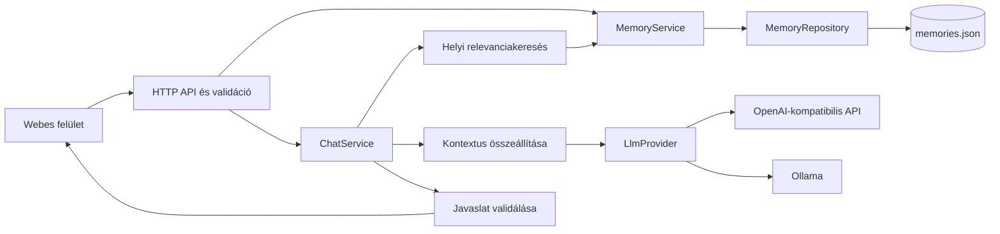

# Home Memory Agent – részletes megvalósítási terv

Dátum: 2026. október 21.

Alap: [specifications.md](./specifications.md), különösen a 3–8., 11–14. és 16. fejezet.

Állapot: megvalósítási javaslat; a dokumentum nem jelent elkészült funkciót vagy elfogadott specifikációmódosítást.

## 1. Kiinduló állapot és cél

A projekt jelenleg a specifikációból, a README-ből és a licencből áll. Nincs alkalmazáskód, függőséglista, teszt, CI vagy Docker-konfiguráció. Emiatt a munka egy új alkalmazás felépítése, meglévő implementációhoz szükséges migráció nélkül. A munkakönyvtárban meglévő README- és specifikációváltozásokat meg kell őrizni.

Az első kiadás célja egy egyfelhasználós, saját gépen vagy szerveren futó alkalmazás, amelyben a felhasználó:

- tartós személyes emlékeket hozhat létre, böngészhet, módosíthat és törölhet;
- ezek releváns részét felhasználó asszisztenssel beszélgethet;
- szolgáltatót válthat az emlékei átalakítása nélkül;
- egy Docker Compose-paranccsal indíthatja az alkalmazást;
- újraindítás és konténercsere után is hozzáfér a mentett emlékekhez.

A fejlesztés központi sorrendje: **megbízható memóriatár → releváns visszakeresés → olvasó chat → ellenőrzött írási javaslatok → teljes felület → kiadás**. Minden funkcióhoz előbb viselkedési példa és érdemi teszt készül.

## 2. A specifikáció tisztázása és javasolt döntések

Az alábbiak közül több nincs eldöntve a specifikációban. Ezek a terv munkafeltételezései; az első fejlesztési feladatban rövid döntési dokumentumban és a specifikációban kell őket egységesíteni.

| Kérdés                              | Megfigyelés                                                                     | Javasolt döntés                                                                                                                                 |
| ----------------------------------- | ------------------------------------------------------------------------------- | ----------------------------------------------------------------------------------------------------------------------------------------------- |
| Természetes nyelvű módosítás/törlés | UC-03/04 és a kezdeti BDD elvárja, a roadmap v0.2-re sorolja.                   | A kifejezett kérések kezelése legyen v0.1. Az automatikus kivonatolás maradjon v0.2. Ez tudatos pontosítás a roadmaphez képest.                 |
| Duplikáció                          | A BDD „egyenértékű” emlékeket említ, a roadmap későbbre teszi a felismerést.    | v0.1: normalizált kategória + tartalom pontos egyezése. Átfogalmazások jelentésbeli összevonása v0.2 vagy később.                               |
| LLM által kért írás                 | A backend validál, de a felhasználói szándék ellenőrzése nincs definiálva.      | A chat strukturált műveleti javaslatot készít. A felhasználó a konkrét javaslat elfogadásával indítja a meglévő CRUD-műveletet.                 |
| Jóváhagyás                          | A roadmap a memória-megerősítést v0.2-re teszi.                                 | Egy egyszerű jóváhagyó kártyát előrehozunk v0.1-re. Tömeges jóváhagyás, automatizálható szabályok és audit későbbi funkciók.                    |
| Beállítások oldal                   | Van UI-követelmény, nincs settings API; kulcs csak környezeti változóból jöhet. | Csak olvasható szolgáltató-, modell- és állapotnézet. Módosítás környezeti változóval és újraindítással.                                        |
| Chat előzménye                      | Az API-példa csak egy üzenetet tartalmaz.                                       | Rövid, szervermemóriában élő beszélgetési előzmény; nincs tartós chatarchívum. Ehhez opcionális `conversationId` kerül az API-ba.               |
| Hozzáférés                          | A komplex felhasználókezelés kizárt, a hálózati védelem nincs meghatározva.     | Egy felhasználó, alapból csak a host loopback címén elérhető port. Távoli használat SSH-alagúttal vagy hitelesített, TLS-es reverse proxyval.   |
| Kategóriák                          | Tetszőleges kategóriák szükségesek.                                             | Szabad szöveges mező, meglévő értékekből ajánlások. Nincs beégetett `hiking`/`travel` üzleti elágazás.                                          |
| Nyelvi támogatás                    | A példák jellemzően angolok; többnyelvű keresés nincs vállalva.                 | UTF-8, magyar és angol példák és tesztek. A lexikai keresés korlátait dokumentáljuk; automatikus fordítást és szemantikus egyezést nem ígérünk. |

Az egyszerű jóváhagyás miatt a természetes nyelvű írás BDD-je is pontosítandó: „kérés → javaslat → elfogadás → tartós változás”. Ez a felhasználói szándékot ellenőrizhető műveletté alakítja. A memóriaűrlap közvetlen mentése továbbra is egyetlen felhasználói művelet.

Ha a cél a roadmap lehető legszűkebb v0.1-e, a természetes nyelvű módosítás/törlés és a kapcsolódó BDD áttehető v0.2-be. A jelen terv a teljes UC-01–05 viselkedést célozza az első kiadásra, ezért a további feladatok ezt követik.

## 3. Hatókör és kiadási mérföldkövek

**v0.1-ben megvalósítandó:**

- TypeScript API, szolgáltatásréteg és cserélhető JSON-repository.
- Memória CRUD, listaszűrés, normalizált pontos duplikációvédelem.
- Helyi, determinisztikus relevanciakeresés és korlátozott LLM-kontextus.
- Chat rövid, ideiglenes előzménnyel; válasz és memóriajavaslat elkülönítése.
- Kifejezett létrehozási, módosítási és törlési kérések, javaslat-elfogadással.
- OpenAI-kompatibilis és natív Ollama-adapter; determinisztikus tesztadapter.
- Chat-, memória- és beállítási felület.
- Validáció, titokmentes hibák és naplózás, helyi elérés biztonságos alapbeállítással.
- Docker, tartós volume, AMD64 és ARM64 ellenőrzés.
- TDD/BDD tesztek, CI és telepítési dokumentáció.

**Későbbre marad:** automatikus emlékkivonatolás minden beszélgetésből; szemantikus deduplikáció; embedding és vektoradatbázis; tartós chatarchívum; streaming válaszok; több felhasználó; beépített regisztráció; webes kutatás; naptár/email; hang; mobilalkalmazás; külső eszközök és automatizálás.

| Mérföldkő                         | Kézzelfogható eredmény                                                            | Kiadási jelentés          |
| --------------------------------- | --------------------------------------------------------------------------------- | ------------------------- |
| M1 – tartós memória               | API-n és kezdeti UI-n keresztül kezelhető, újraindítást túlélő memóriák.          | Belső fejlesztői állapot. |
| M2 – személyre szabott chat       | Két adapterrel működő chat, ellenőrizhetően kiválasztott kontextussal.            | Belső alfa.               |
| M3 – teljes felhasználói folyamat | Jóváhagyható szöveges memóriajavaslatok és kész alapfelületek.                    | Kiadásjelölt.             |
| M4 – v0.1                         | Zöld ellenőrzések, dokumentált telepítés, tartós adatok, ellenőrzött ARM64-futás. | Publikálható első kiadás. |

## 4. Technológia és szerkezet

Javasolt, kis üzemeltetési igényű összeállítás:

| Terület   | Választás                                                            | Indok                                                          |
| --------- | -------------------------------------------------------------------- | -------------------------------------------------------------- |
| Runtime   | A kezdéskor támogatott Node.js LTS, TypeScript strict módban         | Egységes nyelv, a specifikációval összhangban.                 |
| Workspace | npm workspaces, egy gyökér-lockfile                                  | Ehhez a mérethez nincs szükség külön monorepo-keretrendszerre. |
| API       | Express 5, REST, futásidejű sémavalidáció                            | Kicsi HTTP-réteg és egyszerű Supertest-integráció.             |
| Sémák     | Zod vagy az első technikai próbán kiválasztott egyetlen sémakönyvtár | A TypeScript-típus önmagában nem validál bejövő JSON-t.        |
| Frontend  | React + TypeScript + Vite, egyszerű CSS                              | Három kisebb képernyőhöz elegendő; nincs SSR-igény.            |
| Adat      | UTF-8 JSON-fájl, egy írófolyamat                                     | Nincs külön adatbázisszolgáltatás; később cserélhető adapter.  |
| Teszt     | Vitest, Cucumber.js, Supertest, Testing Library                      | Követi a specifikáció ajánlását.                               |
| Telepítés | Egy alkalmazáskonténer, benne API és lefordított webes felület       | Egy origin, egy port, kisebb telepítési felület.               |

A pontos verziókat az alapozó feladatban egymással kompatibilis készletként kell kipróbálni és rögzíteni. A Docker-alapkép és a CI ugyanazt a Node-főverziót használja. A Vite build mellett külön TypeScript-ellenőrzés fusson. Az Express HTTP-szerver, a Vite és a Vitest szerepét a hivatalos dokumentáció alapján választjuk: [Express](https://expressjs.com/en/5x/api/), [Vite](https://vite.dev/guide/), [Vitest](https://vitest.dev/guide/).

```text
apps/
  api/src/
    domain/             # Memory, hibák, repository/provider szerződések
    application/        # MemoryService, ChatService, retrieval, context
    infrastructure/
      persistence/      # JSON és tesztcélú in-memory repository
      llm/              # OpenAI-compatible, Ollama, tesztadapter
    http/               # route-ok, validáció, hibakezelés
    config/             # env-betöltés és validáció
    app.ts              # alkalmazás összeállítása, listen nélkül
    server.ts           # folyamat-életciklus, listen, leállás
  web/src/
    features/chat/
    features/memories/
    features/settings/
    api/
    components/
packages/shared/src/    # publikus DTO-k és közös sémák, titkok nélkül
features/               # Gherkin és Cucumber step definitionök
tests/                  # integrációs segédek és fiktív tesztadatok
data/.gitkeep
docker/Dockerfile
docs/architecture.md
docs/development.md
docs/deployment.md
docs/decisions/
.github/workflows/ci.yml
.env.example
.gitignore
.dockerignore
docker-compose.yml
CONTRIBUTING.md
```

A domain és az application réteg ne importáljon Expresst, fájlrendszert vagy szolgáltatói SDK-t. A HTTP-réteg DTO-kat validál és szolgáltatást hív; a perzisztencia a repository felelőssége. A `shared` csomagba ne kerüljön szerverkonfiguráció vagy provider-kulcs. Kezdetben kézi dependency injection elegendő.



Az LLM-kérés és a fájlművelet között nincs közvetlen út. A jóváhagyott javaslat a felületről a memória API-n át kerül a `MemoryService`-hez.

## 5. Adatmodell és üzleti szabályok

Az első formátum maradjon a specifikációban megadott `Memory[]`, az alábbi mezőkkel:

| Mező        | Jelentés és szabály                                            |
| ----------- | -------------------------------------------------------------- |
| `id`        | A backend által létrehozott UUID, később nem módosítható.      |
| `category`  | Szabad szöveg; trim után 1–80 karakter.                        |
| `content`   | Emlék szövege; trim után 1–2000 karakter.                      |
| `createdAt` | Szerveroldali UTC ISO-időpont, módosításkor változatlan.       |
| `updatedAt` | Szerveroldali UTC ISO-időpont, tényleges módosításkor frissül. |

A limitek javasolt kezdőértékek, és közös sémákban szerepeljenek. Egy emlék egy önálló állítást tartalmazzon. A rendszer az LLM által javasolt túl tág általánosítást nem tekinti bizonyított ténynek; a javaslatot a felhasználó megtekintheti és szerkesztheti.

További szabályok:

1. Normalizált pontos duplikáció: Unicode NFC, szélső whitespace levágása, belső whitespace összevonása és kisbetűsítés után azonos kategória + tartalom. Az eredeti megjelenítési szöveget megőrizzük. Ékezeteket és írásjeleket nem dobunk el a duplikációs azonosságból.
2. Duplikált létrehozás `409 MEMORY_ALREADY_EXISTS`, a meglévő rekord azonosítójával; a UI a már tárolt emléket mutatja. Ugyanez a szabály módosításnál is érvényes.
3. Teljes tartalomcserés módosítás, azonos `id` és `createdAt` mellett. Az előző állítás nem marad aktív külön rekordként.
4. Törléskor az elem kikerül a fájlból, a repository pillanatképéből és a keresési adatokból. Nincs soft delete vagy alapértelmezett tartalmas auditnapló.
5. Párhuzamos szerkesztéshez rekord-ETag készül a teljes aktuális rekordból. A PUT/DELETE `If-Match` értékét a szerver a mutáció kritikus szakaszában ellenőrzi. Elavult érték esetén `412`, hiányzó előfeltételnél `428`.
6. A kategória neve nem jogosultság, és nem befolyásolja, hogy milyen művelet végezhető.
7. Későbbi formátumváltás külön migrációt és mentés/visszaállítási tervet kapjon. A jelenlegi tömbalakot ne változtassuk meg észrevétlenül.

## 6. JSON-perzisztencia: helyesség a sikeres válasz előtt

A JSON-fájl egyszerű infrastruktúrát jelent, de az írások következetességét külön meg kell oldani. A Node dokumentációja szerint a fájlrendszer-műveletek nincsenek automatikusan szinkronizálva; a közös fájl párhuzamos módosítása korrupcióhoz vezethet. [Node.js fájlrendszer API](https://nodejs.org/api/fs.html#promises-api)

**Indulás:**

- A `DATA_PATH` ellenőrzése és az adatkönyvtár létrehozása, ha hiányzik.
- Ha a memóriafájl hiányzik, üres tár inicializálása ugyanazzal a biztonságos írási eljárással.
- Ha a fájl létezik, teljes parse és sémaellenőrzés, beleértve az azonosítóütközéseket.
- Sérült, üresre csonkolódott vagy ismeretlen formátumú fájlt soha ne írjunk felül üres tömbbel. Indulási/readiness hiba, tartalom nélküli diagnózis és helyreállítási útmutató szükséges.

**Egy módosítás menete:**

1. Közös írási sor/zár megszerzése a teljes művelethez.
2. Aktuális állapotból a célrekord, ETag és duplikáció ellenőrzése.
3. Új pillanatkép előállítása a régi módosítása nélkül.
4. Teljes új JSON kiírása egyedi ideiglenes fájlba, ugyanabban az adatkönyvtárban.
5. Fájl flush/sync és lezárás, majd csere átnevezéssel; ahol támogatott, könyvtárszinkronizálás.
6. Az olvasott pillanatkép cseréje kizárólag a tartós commit után.
7. Visszatérés sikerrel, a zár felszabadítása. A fájlcsere előtti hibánál a temp fájl takarítása és a korábbi érvényes állapot megtartása; commit közeli bizonytalan hibánál az alábbi helyreállítási szabály érvényes.

A zárolásnak a teljes read–check–modify–commit részt le kell fednie. A végső `writeFile` sorosítása önmagában nem védi ki az elvesző módosítást. A `MemoryService` üzleti műveleteihez a repository szerződés kapjon atomi mutációs lehetőséget, például `withTransaction` callbacket egy tranzakciós repository-nézettel. Az in-memory és a JSON implementáció ugyanazokat a szerződésteszteket futtassa.

Commit közeli I/O-hibánál, ha nem dönthető el megbízhatóan az állapot, a folyamat ne folytassa régi cache-sel az írást: álljon hibás readiness állapotba, és újraolvasással ellenőrizze a fájlt. Az érvényes pillanatkép helyreállításáig minden memóriát használó CRUD- és chatkérés is `503` hibát kapjon; nem elegendő csak a health státuszát módosítani. A kliens helyreállítás után újraolvassa az állapotot, mielőtt megismételné a műveletet. Tilos minden hibát „üres tárként” kezelni.

**Támogatott üzem:** egy backendfolyamat, egy írható adatkönyvtár, helyi fájlrendszer/Docker-volume. Az adatkönyvtárra szerzett folyamatközi lock a véletlenül elindított második írót utasítsa el; a stale-lock helyreállítás legyen dokumentált és tesztelt. Ne legyen több replica, Node cluster vagy közös NFS-adattár az MVP-ben. A lock-megoldást külön technikai próbában kell ellenőrizni Linuxon és Windows fejlesztői környezetben; ne építsünk általános elosztott zárkezelőt.

**Mentések és törlés:** alapból nincs automatikus `.bak`-forgatás, amely észrevétlenül megtartaná a törölt személyes adatot. Dokumentált, leállított alkalmazás melletti fájl-/volume-mentés és visszaállítás legyen. Az üzemeltető mentései megőrizhetnek törölt adatokat; az alkalmazás törlése nem fizikai lemeztörlés és nem vonja vissza a korábban elküldött külső kontextust.

## 7. Visszakeresés és kontextuskezelés

Az MVP keresése helyben fusson, és ne kérjen LLM-et a teljes memóriatár átnézésére.

**Algoritmus első változata:**

1. Kérdés, kategóriák és tartalmak Unicode-normalizálása és tokenizálása.
2. Kisbetűsítés, külön keresési alakban ékezetfüggetlen összehasonlítás; a tárolt szöveg változatlan.
3. Kis magyar/angol stopwordlista; nincs témához kötött üzleti kategóriafelismerés.
4. Súlyozott egyezés: kezdőértékként 3 pont kategóriatoken-egyezésenként, 1 pont tartalmi tokenegyezésenként, 2 pont értelmes teljes keresőkifejezés-egyezésért. A súlyok tesztadat alapján finomíthatók.
5. Csak pozitív pontszámú találat; csökkenő pontszám, majd stabil azonosítósorrend.
6. Alapból legfeljebb 5 emlék és összesen 6000 karakter emlékkontextus. Ez alkalmazásszintű méretkorlát, nem pontos tokenbecslés.
7. Ha nincs találat, a modell üres emlékkontextust kap. Ne töltsük fel helyette az összes memóriát.

Külön `MemoryRetriever` komponens épüljön, hogy a későbbi szemantikus keresés ne változtassa meg a CRUD-ot. Az első verzióban a kis adathalmaz minden rekordjának helyi vizsgálata elegendő; származtatott indexet csak méréssel indokolt esetben vezessünk be.

**Nyelvi korlát:** a `hiking` és a `túrázás`, illetve a `túra` és egyes ragozott alakjai nem lesznek automatikusan azonosak. A kiadási tesztkészlet külön mérje a magyar, angol és vegyes nyelvű eseteket. Új, tetszőleges kategória ugyanúgy működjön. Kategóriaválasztóval a felhasználó pontosíthassa a keresést; többnyelvű szemantikus keresés későbbi bővítés.

**Prompt összeállítása:**

- Külön rendszerutasítás, egyértelműen elhatárolt emlékadatok, rövid beszélgetési előzmény és aktuális felhasználói üzenet.
- Az emlék szövege adatként kezelendő, akkor is, ha utasításnak látszik.
- A rendszerutasítás ne állítsa, hogy minden emlék mindig aktuális vagy bizonyosan igaz.
- Az aktuális felhasználói javítás elsőbbséget kap a régi emlékkel szemben; tartós változás csak elfogadás után történik.
- A teljes bemenetre és kimenetre is legyen korlát. A provider/model konfigurációhoz illő kontextuskeretet az adapter ellenőrzi; hosszú tartalom ne csonkolja le csendben a legfrissebb kérést.
- A válaszhoz visszaadható `usedMemoryIds` a ténylegesen továbbított rekordokat jelöli. Ez nem bizonyítja, hogy a modell mindegyiket felhasználta a válasz gondolatmenetében.

**Ideiglenes beszélgetés:** javasolt alapérték legfeljebb 12 üzenet, 12 000 karakter, 30 perc inaktivitás, maximum 20 aktív beszélgetés. A `conversationId` szerver által generált véletlen azonosító. Azonos beszélgetésben egyszerre egy kérés fusson; második kérés rendezett elutasítást kapjon. Lejárt vagy újraindítás miatt elveszett beszélgetésnél a UI új beszélgetést indít.

Bármely sikeres memóriamódosítás érvénytelenítse az összes szerveroldali beszélgetési előzményt. Így a törölt tény nem kerül vissza automatikusan egy korábbi asszisztensválaszból. A következő kérés ezt a UI-nak is jelezze. Az előzményekhez és a folyamatban lévő chatkérésekhez tartozzon egy memóriában tartott kontextusgeneráció: mutációnál nő, és az előző generációban indult késői válasz nem írhatja vissza a régi előzményt. Ilyenkor a kliens újraküldést kérő, rendezett hibát kapjon. A külső kérést lehetőség szerint meg kell szakítani, de a már elküldött adat visszavonását nem lehet garantálni.

A módosítást végző felület törölje saját függő javaslatait és aktív chattörténetét. Másik ablakban egy már megjelent javaslat megmaradhat; UPDATE/DELETE esetén az ETag védi a megváltozott célpontot. A javaslatok globális, valós idejű visszavonása nem MVP-követelmény. A régi chat látható szövege nem kerülhet újra automatikusan a szervernek küldött előzménybe.

## 8. Szolgáltatók és ellenőrzött memóriajavaslatok

### 8.1. Adapterek

A domain saját `LlmRequest`/`LlmResponse` típust használjon. Szolgáltatói válaszobjektum ne szivárogjon át az application rétegbe.

Implementációs sorrend:

1. `FakeLlmProvider`: előre beállított válaszok, hibák és rögzített kimenő kérések tesztekhez.
2. `OpenAICompatibleProvider`: konfigurálható base URL, modell, kulcs, chat-üzenetek és válaszleképezés.
3. `OllamaProvider`: natív chat-végpont, modell, üzenetek és válaszleképezés.

Az Ollama chat API strukturált `format` paramétert és streaming beállítást is dokumentál; az első adapter `stream: false` módban működjön. A tényleges strukturált válasz minőségét a választott modellel külön is ellenőrizni kell. [Ollama chat API](https://docs.ollama.com/api/chat)

Mindkét adapter feladata: megszakítható kérés, konfigurálható időkorlát, maximális válaszméret, titokmentes hibák és az ismeretlen válaszformátum elutasítása. Kezdő timeout-javaslat 60 másodperc, helyi modellhez konfigurálhatóan hosszabb; a UI a megszakítást kezelje.

A provider-kompatibilitás nem jelent minden modellnél azonos képességeket. Külön jelezni kell a strukturált javaslatok támogatását. Ha ez nem támogatott vagy a válasz hibás, a normál chat és a kézi CRUD továbbra is használható; a rendszer ne állítson sikeres emlékírást.

Ne legyen automatikus átváltás másik külső szolgáltatóra. Alapból ne ismételjük meg automatikusan a modellhívást sem: a felhasználó tudja újraküldeni, egyértelmű hibajelzés után. Későbbi retry csak korlátozottan, adatvédelmi és költségszabályokkal együtt kerülhet be.

### 8.2. Műveleti szerződés

A belső modellkimenet egy diszkriminált unió legyen:

```typescript
type MemoryAction =
  | { action: 'CREATE_MEMORY'; memory: { category: string; content: string } }
  | { action: 'UPDATE_MEMORY'; id: string; memory: { category: string; content: string } }
  | { action: 'DELETE_MEMORY'; id: string };

type AgentDecision =
  | { kind: 'answer'; message: string }
  | { kind: 'clarification'; message: string }
  | { kind: 'proposal'; action: MemoryAction };
```

Ez szerződésvázlat, nem kész implementáció. Az ETag-et és más végrehajtási metaadatot mindig a backend kapcsolja a javaslathoz, nem az LLM állítja elő.

**Feldolgozási lépések:**

1. A kérés méretének és sémájának ellenőrzése.
2. Releváns emlékek és lehetséges módosítási célpontok helyi kiválasztása. A jelöltlista korlátozott; nem kapja meg a modell a teljes tárat.
3. Modellhívás a szükséges kontextussal.
4. Válasz teljes futásidejű validációja: engedélyezett típus, kötelező mezők, méret, ismeretlen mezők/műveletek elutasítása.
5. UPDATE/DELETE esetén a célpont létezésének és a modellnek átadott jelöltlistához tartozásának ellenőrzése.
6. Nulla vagy többértelmű célpont esetén pontosítás/jelöltválasztás, állapotváltozás nélkül.
7. Egy kérés legfeljebb egy javaslatot eredményezhet. Nincs szabad eszközhívás vagy korlátlan agent-ciklus.
8. A UI megmutatja a műveletet, az érintett emléket és módosításkor az előtte/utána tartalmat.
9. Elfogadáskor a UI a POST/PUT/DELETE memória API-t hívja; a backend ismét validál, ellenőrzi az ETag-et, és a `MemoryService` végzi a tranzakciót.
10. „Elmentettem”, „módosítottam”, „töröltem” visszajelzést a frontend a tényleges API-eredményből készít. Előzetes LLM-szöveg nem számít végrehajtási eredménynek.

A javaslat elutasítása, hibás modellkimenet, időtúllépés és hétköznapi kérdés esetén nincs automatikus írás. A javaslat szerkesztése közvetlen felhasználói CRUD-bemenetté válik. Nincs szükség tartós javaslat-adatbázisra vagy új általános műveletvégrehajtó API-ra.

Az újraküldött chat nem módosít adatot. Dupla elfogadást a felület gombtiltása mellett a backend pontos duplikációellenőrzése és az ETag előfeltétele is védi. Tartós, általános idempotenciakulcs-tár csak akkor szükséges, ha később háttérből automatikusan végrehajtott műveletek is lesznek.

## 9. API-szerződések

| Végpont                    | Bemenet                                                   | Sikeres eredmény                                                                      |
| -------------------------- | --------------------------------------------------------- | ------------------------------------------------------------------------------------- |
| `GET /api/health`          | Nincs                                                     | `200`: alkalmazás és memóriatár kész; tárolási hibánál `503`. Nem hív fizetős LLM-et. |
| `GET /api/memories`        | Opcionális `category`, `q`, `limit`, `offset`             | `200 { items, total }`; stabil rendezés, alaplimit 50, maximum 100.                   |
| `POST /api/memories`       | `{ category, content }`                                   | `201`, létrehozott emlék és ETag.                                                     |
| `GET /api/memories/:id`    | Azonosító                                                 | `200`, emlék és ETag.                                                                 |
| `PUT /api/memories/:id`    | `{ category, content }`, `If-Match`                       | `200`, módosított emlék és új ETag.                                                   |
| `DELETE /api/memories/:id` | Azonosító, `If-Match`                                     | `204`, csak commit után. Ismételt törlésnél `404`.                                    |
| `POST /api/chat`           | `{ message, conversationId? }`, opcionális kategóriaszűrő | `200`, chatválasz vagy jóváhagyandó javaslat.                                         |
| `GET /api/settings`        | Nincs                                                     | `200`, engedélyezett, nem titkos konfigurációs és készültségi mezők.                  |

A `settings`, a lapozás, az ETag és a beszélgetésazonosító a terv javasolt kiegészítései. A listában egy elemhez a szerkesztéshez szükséges ETag-metaadat is visszaadható; nem kell azt az emlék üzleti mezői közé menteni.

A settings válasz engedélyezett mezői például: provider neve, modell, konfiguráltság, strukturált javaslat támogatása és az üzemeltető által megadott local/external mód. Nyers env-objektum, kulcs, hitelesítést tartalmazó URL és belső fájlút ne kerüljön vissza. Egy URL-ből önmagában ne állítsuk biztosan, hogy minden feldolgozás helyi.

Példa chatválasz olvasási kérésre:

```json
{
  "message": "A korábbi felszerelésed alapján érdemes fejlámpát is vinned.",
  "conversationId": "conversation-opaque-id",
  "usedMemoryIds": ["memory-uuid"],
  "proposal": null
}
```

Javaslat esetén a `proposal` tartalmazza a validált műveletet és UPDATE/DELETE-nél a backend által kiolvasott célrekordot, illetve ETag-et. A `message` ilyenkor a backend által előállított „Javasolt módosítás” jellegű szöveg; nem „Módosítottam”.

Egységes hibaformátum:

```json
{
  "error": {
    "code": "MEMORY_NOT_FOUND",
    "message": "A kért emlék már nem található.",
    "requestId": "request-opaque-id"
  }
}
```

Hibacsoportok: `400` hibás bemenet; `404` hiányzó rekord; `409` duplikáció/foglalt beszélgetés; `410` lejárt beszélgetés; `412` elavult ETag; `413` túl nagy kérés; `428` hiányzó előfeltétel; `429` helyi terheléskorlát; `502` hibás külső válasz; `503` nem konfigurált vagy nem kész szolgáltatás/tár; `504` provider-timeout. A provider-hitelesítési hiba belső hibakóddal jelenjen meg, nyers upstream body nélkül.

## 10. Felhasználói felület

**Chat:** üzenetlista, beviteli mező, küldés/megszakítás, folyamatjelzés és újrapróbálható hiba. A felhasználó megnyithatja a kontextusba küldött emlékek listáját. A memóriajavaslat külön kártya; módosításkor régi és új szöveg, törléskor egyértelmű célpont. Elfogadás/elutasítás, siker és hiba külön állapot legyen. A bevitelt a folyamatban lévő kérés alatt kezeljük következetesen, dupla küldés nélkül.

**Memóriák:** lista, üres állapot, kategóriaszűrő és szöveges keresés; létrehozó és szerkesztő űrlap; törlés megerősítéssel; duplikáció és ütköző szerkesztés érthető hibája. A kategóriamező szabadon írható. Mentés után a lista frissüljön; sikertelen mentés ne jelenjen meg kész eredményként.

**Beállítások:** konfigurált szolgáltató/modell, API- és tárállapot, jelzés az előzmények ideiglenességéről, a helyi tárolás és a konfigurált LLM felé küldött adatok magyarázata. Hiányzó provider esetén a memóriák továbbra is kezelhetők, a chat beállítási útmutatót mutat. Nincs API-kulcs mező a böngészőben.

Az első felület legyen reszponzív, billentyűzettel használható, feliratozott mezőkkel és látható fókuszállapottal. A modell- és memóriaszöveget kezdetben egyszerű szövegként jelenítsük meg; a nyers HTML ne fusson le. Markdown-támogatás csak külön sanitizálással kerüljön be. Személyes szöveget ne tároljunk `localStorage`-ban.

## 11. Megvalósítás feladatokra bontva

Minden fázis önállóan ellenőrizhető eredményt adjon. Egy fázis több kicsi PR-ra bontható; a feladatok teljesítéséhez az elfogadási feltételt kell elérni, nem pusztán fájlokat létrehozni.

| Fázis                              | Előfeltétel | Feladatok és eredmény                                                                                                                                              | Elfogadási feltétel                                                                                                                   | Becsült munka |
| ---------------------------------- | ----------- | ------------------------------------------------------------------------------------------------------------------------------------------------------------------ | ------------------------------------------------------------------------------------------------------------------------------------- | ------------- |
| P0 – specifikáció egységesítése    | Nincs       | Scope, jóváhagyás, nyelvek, chat-előzmény, settings és hozzáférés döntései; követelmény–teszt megfeleltetés.                                                       | Nincs olyan kötelező v0.1 BDD, amelyet a roadmap későbbre halaszt.                                                                    | 0,5–1 nap     |
| P1 – projektalap                   | P0          | npm workspaces, strict TS, lint/format, tesztparancsok, üres Express app, env-validáció, `.gitignore`/`.dockerignore`, minimális Dockerfile és CI.                 | Tiszta telepítés, lint, typecheck, egy valós health-teszt és Docker-build zöld.                                                       | 1–2 nap       |
| P2 – első memória és tartós tár    | P1          | BDD RED; MemoryService és repository TDD; create/list/get; JSON commit, sorosítás és lock; egységes hibaformátum.                                                  | API-n létrehozott emlék új repository-/folyamatindítás után is megvan; párhuzamos írás nem veszít adatot.                             | 2–3 nap       |
| P3 – teljes CRUD                   | P2          | PUT/DELETE, ETag, validáció, pontos duplikáció, szűrés/lapozás; első memóriafelület.                                                                               | Módosítás/törlés újraindítás után is helyes; két böngészős elavult szerkesztés nem ír felül csendben. M1 kész.                        | 2–3 nap       |
| P4 – relevancia és kontextus       | P3          | MemoryRetriever, pontozás, kontextuskorlátok, magyar/angol tesztadatok, prompt builder.                                                                            | Releváns/irreleváns találatok és limithelyzetek determinisztikusan teszteltek; teljes tár nem jut ki.                                 | 1–2 nap       |
| P5 – chat fake providerrel         | P4          | ChatService, rövid beszélgetéskezelés és mutáció utáni érvénytelenítés, kontextusgeneráció, közös input/response/műveleti sémák, chat endpoint és első chat UI.    | Kimenő kontextus vizsgálható; timeout/hiba, lejárt beszélgetés, előzménykorlát és késői válasz eldobása tesztelt.                     | 1–2 nap       |
| P6 – két valódi adapter            | P5          | OpenAI-compatible és Ollama HTTP-leképezés, megszakítás, hibanormalizálás, adaptertesztek helyi stub szerverrel.                                                   | Azonos domain-tesztek mindkét adapterre; külön opt-in élő smoke; provider-váltáskor ugyanaz a memóriatár. M2 kész.                    | 2–3 nap       |
| P7 – természetes nyelvű műveletek  | P3, P5, P6  | Strukturált döntés, jelöltazonosítók, javaslatvalidáció, pontosítás, elfogadó kártya és CRUD-végrehajtás.                                                          | UC-02–04 végigmegy; hibás/idegen művelet és elutasított javaslat nem ír; siker csak commit után.                                      | 2–4 nap       |
| P8 – teljes felület és adatvédelem | P3, P7      | Settings endpoint/oldal, reszponzív és hozzáférhető állapotok, naplóredakció, kéréskorlátok, előzményérvénytelenítés UI-jelzése és teljes adatvédelmi ellenőrzése. | Fő folyamatok kézzel bejárhatók, kritikus UI-viselkedések teszteltek, titok és személyes tartalom nem kerül logba/bundle-be. M3 kész. | 2–3 nap       |
| P9 – telepítés és kiadás           | P8          | Compose-volume, non-root futás, AMD64/ARM64 build és smoke, helyreállítási próba, README/CONTRIBUTING, teljes kiadási ellenőrzés.                                  | Friss checkoutból indítható, csere után adat megmarad, platformtesztek és teljes CI zöld. M4 kész.                                    | 2–3 nap       |

Összesen körülbelül **15,5–26 mérnöknap** egy fejlesztővel, a fázisok tesztelésével együtt. Integrációs és platformkockázatokra 20–30% tartalékkal **19–34 mérnöknap** tervezhető. Ez előzetes ráfordításbecslés, nem vállalt naptári határidő; modellminőség, fejlesztői környezet és ARM64-hozzáférés módosíthatja. A P6 technikai próbája után érdemes újrabecsülni.

**Párhuzamosítható munka:** P1 után a felület közös DTO-kra és fiktív adatokra épülhet; P3 után a CRUD UI és a retrieval külön haladhat; P5 után a két adapter önállóan készülhet. A Docker/ARM64 technikai próbát már P1-ben el kell indítani, a végső validáció P9-ben történik. A közös szerződéseket előbb rögzíteni kell, különben a párhuzamosítás újramunkát okoz.

A strukturált műveleti kimenet sémái P5-ben rögzülnek. P6 ezekkel végez adapter- és modellpróbát, P7 pedig a javaslat ellenőrzését és elfogadási felületét köti a teljes felhasználói folyamatba.

## 12. Tesztstratégia és konkrét elfogadási esetek

A specifikáció szerinti ciklus minden üzleti funkciónál: **Gherkin → hibázó acceptance teszt → hibázó unit teszt → minimális implementáció → zöld tesztek → refaktor**. A BDD a publikus API-n keresztül vizsgálja az eredményt; a fájlformátumra vonatkozó ellenőrzés repository-integrációs teszt.

| Tesztszint          | Mit vizsgál?                                                                                 | Futtatás                                                  |
| ------------------- | -------------------------------------------------------------------------------------------- | --------------------------------------------------------- |
| Unit                | Validáció, MemoryService-szabályok, normalizálás, pontozás, kontextuskeret, döntésvalidáció. | Vitest, fake óra/azonosító ahol szükséges.                |
| Repository contract | Az in-memory és JSON repository azonos CRUD- és tranzakciós viselkedése.                     | Közös tesztcsomag, JSON-hoz külön temp könyvtár.          |
| Integráció          | HTTP → service → tár; fájlhibák, konkurencia, provider HTTP-leképezés.                       | Supertest és helyi stub provider, valódi temp fájlok.     |
| BDD                 | UC-01–05, szolgáltatóváltás, hibás művelet, relevancia.                                      | Cucumber.js, `FakeLlmProvider`, publikus interfészek.     |
| UI                  | Űrlapok, küldés, ütközés, javaslat elfogadása/elutasítása, hibák.                            | Testing Library, viselkedésközpontú ellenőrzés.           |
| Kiadási smoke       | Konténer, volume, újraindítás, ARM64, valódi modellek alapfolyamatai.                        | Külön release/opt-in ellenőrzés; személyes adatok nélkül. |

A BDD nem igényel minden forgatókönyvhöz böngészőautomatizálást. Playwright nem blokkolja az első funkciókat; a stabil kiadás környékén néhány fontos UI-folyamatra opcionálisan hozzáadható. Nincs teszt pusztán azért, hogy az implementáció minden sorát megismételje.

**Kötelező viselkedési esetek:**

| Azonosító | Forgatókönyv                                    | Elvárt eredmény                                                       |
| --------- | ----------------------------------------------- | --------------------------------------------------------------------- |
| A01       | Üres tárba egy memória létrehozása              | Pontosan egy rekord, helyes tartalom és szerveroldali metaadatok.     |
| A02       | Tetszőleges új kategória                        | Kódmódosítás nélkül létrehozható és szűrhető.                         |
| A03       | Üres, túl hosszú, hibás JSON-bemenet            | Rendezett hiba, változatlan állapot.                                  |
| A04       | Normalizálva azonos új emlék                    | Egy rekord marad, a meglévő azonosítható.                             |
| A05       | Meglévő emlék pontosítása                       | Ugyanaz az ID, megőrzött létrehozási idő, új tartalom.                |
| A06       | Elavult szerkesztés/törlés                      | `412`, az újabb tartalom megmarad.                                    |
| A07       | Emlék törlése, majd újraindítás                 | Sem listában, sem keresésben, sem aktív fájlban nincs jelen.          |
| A08       | Párhuzamos különböző létrehozások               | Egyik sem vész el; a fájl érvényes.                                   |
| A09       | Sérült fájl vagy írási hiba                     | Nincs üresre visszaállítás és hamis siker.                            |
| A10       | Releváns és irreleváns emlékek                  | A megfelelő kontextus kerül ki, limit és stabil sorrend betartva.     |
| A11       | Nincs találat                                   | Üres memóriakontextus; nem a teljes tár a fallback.                   |
| A12       | Chat fake providerrel                           | Az összeállított kérés pontosan ellenőrizhető.                        |
| A13       | Kifejezett „jegyezd meg” kérés                  | Javaslat; elfogadás után tárolt emlék, előtte nincs változás.         |
| A14       | Kifejezett módosítás/törlés                     | Megfelelő célpont és előnézet; elfogadás után helyes tartós állapot.  |
| A15       | Több lehetséges célpont                         | Pontosítás vagy felhasználói kiválasztás, nincs önkényes írás.        |
| A16       | Hibás séma, kitalált ID, ismeretlen action      | A javaslat elutasítva, tár változatlan.                               |
| A17       | Emlékbe ágyazott rosszindulatú utasítás         | Nem ad automatikus írási képességet a modellnek.                      |
| A18       | Elutasított vagy kétszer elfogadott javaslat    | Elutasításnál nincs változás; ismétlés nem hoz újabb duplikátumot.    |
| A19       | Provider-timeout, hibás hitelesítés, hibás body | Érthető, titokmentes hiba, nincs hamis mentés.                        |
| A20       | Szolgáltatóváltás                               | Memóriák változatlanok, azonos szolgáltatásszerződés működik.         |
| A21       | Memóriatörlés után korábbi chat folytatása      | Előzmény érvénytelenítve; a régi tény nem kerül automatikusan vissza. |
| A22       | Titkot tartalmazó upstream hiba                 | Kulcs és nyers személyes tartalom nincs API-hibában vagy naplóban.    |
| A23       | Konténercsere és volume újracsatolás            | Mentett emlékek megmaradnak, nem root felhasználóval írhatók.         |
| A24       | ARM64 futtatás                                  | Indulás, health, CRUD és újraindítás ténylegesen ellenőrzött.         |

Az A13–A14 BDD-je szándékosan tartalmazza a jóváhagyási lépést, összhangban a terv 2. pontjának javaslatával. Példa:

```gherkin
Feature: Explicit memory update

  Scenario: User approves a correction to an existing preference
    Given the assistant remembers that the user takes 2 litres of water on every hike
    When the user asks to change this to long hikes only
    Then the assistant should propose a correction to that memory
    And the stored memory should remain unchanged
    When the user approves the correction
    Then the existing memory should mention long hikes only
    And the obsolete preference should no longer be active
```

A normál tesztparancs és CI ne hívjon valódi fizetős LLM-et. Az élő smoke külön kapcsolóval, fiktív adatokkal fusson. A fake providerrel zöld tesztek a vezérlést igazolják; a valódi modell magyar/angol megértését és strukturált válaszait külön, verziózott példakészlettel kell ellenőrizni.

## 13. Adatvédelem, konfiguráció és üzemeltetés

**Konfiguráció:** a specifikáció változói (`LLM_PROVIDER`, `LLM_BASE_URL`, `LLM_API_KEY`, `LLM_MODEL`, `DATA_PATH`) mellett javasolt `PORT`, `LOG_LEVEL`, `LLM_TIMEOUT_MS` és kontextuslimitek. A beállításokat induláskor validáljuk. Hiányzó LLM-beállításnál a CRUD elindulhat; félreírt, explicit szolgáltatóbeállításnál egyértelmű konfigurációs hibát jelezzünk. A kulcs kizárólag a szerver futásidejű környezetéből származhat.

**Adatok védelme:** `.env`, minden valós `data`-tartalom, ideiglenes memóriafájl, lock és kézi backup legyen Git- és Docker-build-context kizárásban. Csak fiktív fixture kerüljön verziókezelésbe. Ne legyen analytics vagy telemetria az MVP-ben. Naplózzunk request ID-t, hibakódot, időtartamot és művelettípust; memória-, chat-, kulcs- és nyers provider-választ ne.

**HTTP:** same-origin frontend/API; fejlesztéskor Vite proxy; nincs általános `*` CORS. Korlátozott JSON-body, mezőhossz, párhuzamos chatkérések és helyi rate limit. Módosító végpontoknál megfelelő content type és origin/host ellenőrzés. Provider URL csak üzemeltetői konfigurációból jöhet, nem chatüzenetből; a redirect ne kerülje meg ezt a határt. A CORS önmagában nem hozzáférésvédelem.

**Docker:** több lépcsős build, futtatásra csak szükséges csomagok és webes build; fix nem root UID/GID; írható `/app/data`, megfelelően előkészített volume-jogosultságok; titkok kizárólag futásidőben. A konténer belül hallgathat `0.0.0.0` címen, a Compose host portkötése alapból `127.0.0.1`. A leállás fejezze be a folyamatban lévő commitot, és zárja le a szerver erőforrásait.

A Compose alapváltozata csak az alkalmazást futtassa. Az Ollama lehet már meglévő helyi szolgáltatás; opcionális külön Compose-profil később vagy dokumentált példaként adható. A konténer `localhost` címe nem a host gép: a hoston és külön konténerben futó Ollama eléréséhez külön példát kell adni Linuxon és Docker Desktopon. Az Ollama-modell letöltése és erőforrásigénye külön üzemeltetési feladat.

**ARM64:** `linux/amd64` és `linux/arm64` build, lehetőleg natív futtatási smoke. Emuláció használható, de önmagában nem helyettesíti a Raspberry Pi-n vagy más ARM64 hoston végzett futásellenőrzést. A Docker többplatformos build támogatását a hivatalos útmutató írja le. [Docker multi-platform builds](https://docs.docker.com/build/building/multi-platform/)

Az alkalmazás ARM64-kompatibilitása és egy nagy helyi LLM Raspberry Pi-n elérhető válaszideje külön kérdés. A v0.1 kiadási feltétele az alkalmazás futása; a modellsebességhez konkrét hardveres mérés szükséges.

## 14. CI és kiadási feltételek

Minden PR-on: `npm ci → lint → typecheck → unit → integration → BDD → UI tests → build → Docker build`. A tesztlépések a függőségek telepítése után önálló jobokban is futhatnak, de a merge mindegyik sikerétől függjön. A TypeScript-build nem helyettesíti a teszteket, és a frontend build nem helyettesíti a külön typechecket.

Windows-fejlesztés miatt a JSON-repository tesztjei Linuxon és Windowson is fussanak. A teljes böngészős mátrix nem MVP-követelmény. ARM64 buildet már korán próbáljunk; a kiadási pipeline-ban mindkét célplatform legyen ellenőrzött. PR-ból registry-publikálás és valódi LLM-kulcs használata ne történjen.

Javasolt gyökérparancsok: `dev`, `lint`, `typecheck`, `test:unit`, `test:integration`, `test:bdd`, `test:ui`, `build`, `test:providers:live`. Ezeket a P1 feladat hozza létre; jelenleg még nem léteznek.

**v0.1 kész, ha:**

- az A01–A24 feltételek teljesültek, a platformhoz kötött ellenőrzések bizonyítéka rögzített;
- minden UC-01–05 végigjátszható a felületen, az elfogadott pontosításokkal;
- a CI, a két platform buildje és a dokumentált telepítési próba sikeres;
- sikeres az újraindítás, konténercsere, valamint a mentésből visszaállítás próbája;
- az alkalmazás mindkét providerrel kipróbált, fiktív adatokkal;
- nincs ismert adatvesztési, titokszivárgási vagy ellenőrizetlen írási hiba;
- a README egyértelműen leírja a külső LLM-hez küldött adatokat, a keresés korlátait és a támogatott telepítést;
- a fejlesztői útmutató leírja a TDD/BDD menetét és új adapter hozzáadását.

## 15. Kockázatok és a döntést segítő mérések

| Kockázat                                         | Korai ellenőrzés                                                                             | Válasz, ha nem megfelelő                                                                                                 |
| ------------------------------------------------ | -------------------------------------------------------------------------------------------- | ------------------------------------------------------------------------------------------------------------------------ |
| Magyar nyelvű lexikai keresés kevés találatot ad | P4: legalább 20 fiktív magyar/angol keresési példa, várt releváns és irreleváns rekordokkal. | Normalizálás és kategóriapontosítás javítása; szemantikus igény külön következő fázis, nem rejtett teljes-tár feltöltés. |
| Kis helyi modell hibás strukturált választ ad    | P6: mindhárom művelettípus és negatív esetek a kiválasztott modellel.                        | Javaslatképesség korlátozása és kézi CRUD; a támogatott modellek listájának pontosítása.                                 |
| JSON elvesző vagy hibás írás                     | P2: párhuzamos kérések, I/O-hibainjektálás, commit környéki folyamatleállítás.               | A perzisztenciaréteg javítása minden további funkció előtt.                                                              |
| Windows/Linux eltérő fájlviselkedés              | P1/P2 technikai próba és két OS-en futó teszt.                                               | A támogatott tárolási környezet szűkítése, dokumentált eltérés; nincs hamis atomikussági garancia.                       |
| Adat bennragad logban vagy előzményben           | P5/P8: jellegzetes fiktív titokkal végigfuttatott hiba és törlés.                            | Naplóredakció, előzményérvénytelenítés és regressziós teszt.                                                             |
| A scope túl nagy lesz                            | P0: kötelező MVP és következő verziók elkülönítése.                                          | Streaming, automatikus kivonatolás, auth-rendszer és integrációk későbbre.                                               |
| ARM64 csak lefordul, de nem működik              | P1 korai build, P9 natív smoke.                                                              | Kiadás blokkolása a platformhiba rendezéséig; ellenőrizetlen támogatást nem hirdetünk.                                   |

Teljesítményhez 100, 1000 és 10 000 fiktív emlékkel mérjük a CRUD és a helyi keresés idejét, a memóriahasználatot és a JSON-fájl méretét. Kezdő mérési cél 1000 emléknél 250 ms alatti p95 helyi keresés, LLM nélkül, dokumentált hardveren; ez javasolt célérték, nem már igazolt tulajdonság. A mérések alapján határozzuk meg a támogatott adatmennyiséget és azt, mikor indokolt SQLite-ra váltani.

## 16. Következő verziók

| Verzió                 | A v0.1-re épülő munka                                                                                                 | Belépési feltétel                                                                                                   |
| ---------------------- | --------------------------------------------------------------------------------------------------------------------- | ------------------------------------------------------------------------------------------------------------------- |
| v0.2 – Smart Memory    | Automatikus kivonatolás, prioritás, átfogalmazások deduplikációja, fejlettebb jóváhagyás; szükség esetén tartós chat. | A kézi és explicit javaslatos folyamat megbízható, vannak valós minőségi példák.                                    |
| v0.3 – Semantic Memory | Elsősorban SQLite-adapter, szükség esetén PostgreSQL; embeddings, szemantikus retrieval, lejárat/archívum.            | Mérés vagy használati tapasztalat mutatja a JSON/lexikai megoldás korlátját; migráció és visszaállítás megtervezve. |
| v0.4 – Agent Tools     | Engedélyezett eszközregiszter, időjárás/naptár/jegyzet adapterek, műveletenkénti jogosultság.                         | A belső műveletszerződés stabil; a külső mellékhatások kezelése külön definiált.                                    |
| v0.5 – Automation      | Ütemezett és eseményvezérelt feladatok, ismétlésvédelem, futásállapot, felhasználói értesítés.                        | Tartós feladattár, retry/idempotencia és kézbesítési szabályok rendelkezésre állnak.                                |

## 17. Az első konkrét fejlesztési munkacsomag

Az első implementációs körben P0 és P1 után kizárólag a specifikáció 16.9 szerinti „Store a memory” függőleges szelet készüljön el:

1. `memory-creation.feature` megírása, a publikus API-n keresztül.
2. Futtatás és a hiányzó működésből eredő piros állapot ellenőrzése.
3. `MemoryService` create/list viselkedés unit tesztje fake repositoryval, órával és ID-generátorral.
4. Minimális domain, sémák, service és in-memory adapter.
5. JSON-adapter, atomi commit és a létrehozás/újraolvasás integrációs tesztje.
6. `POST /api/memories`, `GET /api/memories` és központi hibakezelés bekötése.
7. BDD zöld, majd refaktor; hibás bemenet és tárolási hiba ellenőrzése.
8. Dockerből létrehozás, újraindítás és visszaolvasás kézi smoke-ja.
9. Rövid fejlesztői útmutató frissítése és teljes CI-futtatás.

Ennek az eredménye egy kicsi, végig működő és tartósan tároló alap, amelyre a további funkciók már ellenőrzött viselkedéssel épülhetnek.

## v0.2 Smart Memory – megvalósított viselkedés

- A memória `low`, `normal` vagy `high` prioritást kap; a retrieval csak releváns találatok között használja ezt a sorrend finomítására. A régi JSON rekordok prioritás nélkül `normal` értékkel töltődnek be.
- A chat egy tartós preferenciát vagy visszatérő szokást felajánlhat mentésre. A szerver csak egyértelmű minták esetén jeleníti meg ezt, kiszűri a gyakori érzékeny adattípusokat, és közeli meglévő memóriát is ellenőriz.
- A felhasználó természetes nyelven jelezheti, hogy egy korábbi szokás vagy preferencia megváltozott. A modell csak a retrieval által kijelölt jelöltre javasolhat módosítást vagy törlést; bizonytalan célpontnál pontosítást kér.
- A javaslatkártyán látható, hogy explicit kérés vagy automatikus emlékötlet indította-e a javaslatot. A felhasználó mentés előtt átírhatja a kategóriát, tartalmat és prioritást. Elfogadás nélkül nincs írás.
- A duplikációvédelem az eddigi pontos egyezés mellett azonos kategórián belül nagy bizonyosságú token- és néhány ismert szóváltozat-egyezést keres. Ellentmondó tagadást vagy számértéket tartalmazó tényeket nem tekint automatikusan azonosnak. Ez nem szemantikus keresés; az továbbra is a v0.3 témája.
- A chat-előzmény továbbra is csak ideiglenes. Tartós beszélgetés-archívum nem szükséges ehhez a verzióhoz.
